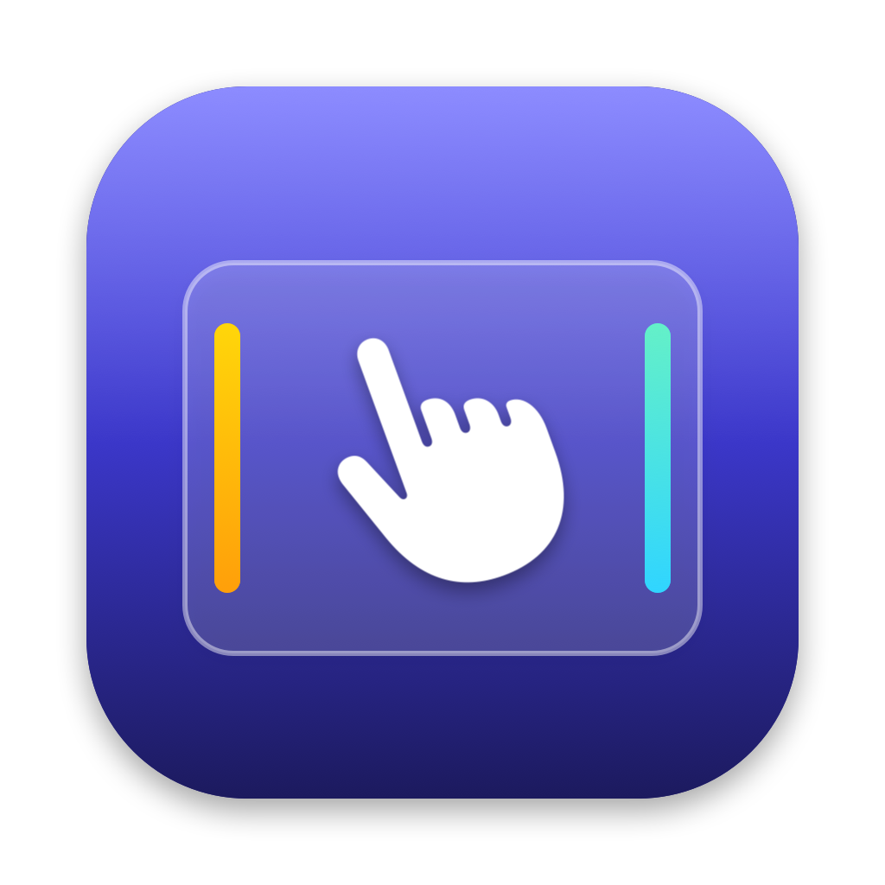

# Padlet

Your trackpad, with a few more tricks. Padlet is a menu bar app for macOS that turns trackpad
edges into controls and adds gestures macOS doesn't have — with per-app overrides.

<p align="center"></p>

## Features

**Edge controls** — slide one finger along a side edge:

| Where | Gesture | Does |
|---|---|---|
| Left / right edge | Slide up or down | Volume, Brightness, Keyboard Light, Scroll, Zoom or Off — your pick per edge |
| Top-right corner | Double-tap | Mute / unmute |
| Bottom edge | Swipe left / right | Previous / next track |
| Bottom edge | Double-tap (off by default) | Play / pause |

The native volume / brightness bezel shows while you slide. Hold **⇧⌥** for quarter steps.
Each step gives a haptic tick (Off / Light / Medium / Strong — driven through the trackpad's
Force Touch actuator, so the strengths really differ).

**Gestures** — each family can be switched on or off, each slot mapped to an action:

| Gesture | Default |
|---|---|
| Three-finger tap / click (hold) | Middle Click / — |
| Four-finger tap / click (hold) | — / — |
| Force click in a corner (4 corners) | Top-left: Mission Control |
| Quick flick along the top edge ← / → | Previous Space / Next Space |

Actions: Middle Click, Mission Control, App Exposé, Show Desktop, Previous / Next Space,
Previous / Next Tab, any keystroke (with ⌘⇧⌥⌃), or open an app.

**App profiles** — while a given app is in front, any gesture can do something else
(e.g. three-finger tap = Next Tab in Safari). Unchanged gestures use your main mapping.

**Comfort** — freeze the pointer while sliding, ignore edge touches right after typing,
lower-25%-only mode, require Fn/⌥, adjustable edge width and sensitivity, palm rejection.

**Everything else** — master on/off switch (left-click the menu bar icon for the panel,
right-click for quick switches), Light / Dark / System appearance, Open at Login (on by default),
and automatic updates from GitHub Releases.

## Install

1. Download `Padlet.dmg` from [Releases](https://github.com/vuhpquang/mac-shortcuts/releases) and drag **Padlet** to Applications.
2. Open it. Padlet isn't notarized by Apple, so the first launch may be blocked: open
   System Settings → Privacy & Security and click **Open Anyway**.
3. The welcome guide walks you through granting **Accessibility** access
   (System Settings → Privacy & Security → Accessibility → Padlet).
4. Padlet lives in the menu bar — there is no Dock icon.

Requires macOS 13 Ventura or later and a Force Touch trackpad (built-in or Magic Trackpad).

> Upgrading from **Mac Shortcuts**: your settings are imported automatically on first launch.
> Accessibility must be granted again because Padlet is a new app identity.

## Privacy

Padlet only reads trackpad contact positions and pressure, plus whether a key was pressed
(not which key) for the typing guard. It never sees your screen or what you type. The only
network request is the update check to the GitHub Releases API.

## Development

```bash
swift build                  # debug build
swift test                   # unit tests (recognizers, settings, migration)
./build.sh                   # signed Padlet.app + Padlet.dmg in build/
swift scripts/make-icon.swift Sources/Padlet/Resources/AppIcon.png   # regenerate the icon
```

**Signing.** `build.sh` signs with the **Padlet Self-Signed** identity when it is in the
keychain, otherwise ad-hoc. The self-signed certificate keeps the app's designated
requirement stable, so the Accessibility grant survives updates, and the updater only
accepts a new version signed by the same certificate. Ad-hoc builds lose the grant on every
rebuild. To sign on another Mac, import the backed-up identity:
`security import padlet-signing.p12 -k ~/Library/Keychains/login.keychain-db -T /usr/bin/codesign`.
`TEAM_ID="Developer ID Application: …" ./build.sh` signs with a real Apple certificate;
add `NOTARIZE=1` to notarize (the only way past Gatekeeper without "Open Anyway").

**DMG.** The background is drawn by `scripts/make-dmg-background.swift` into `packaging/`;
the Finder layout is in `scripts/dmg-settings.py` and written by
[dmgbuild](https://github.com/dmgbuild/dmgbuild), which `build.sh` installs into a private
venv under `.build/`.

DEBUG builds have two hooks:

```bash
PADLET_SNAPSHOT=/tmp/shots .build/debug/Padlet   # render every screen (light + dark) to PNG
PADLET_UPDATE_DRYRUN=1 .build/debug/Padlet       # check → download → verify an update, no install
```

### Layout

```
Sources/Padlet/
  App/          entry point, AppDelegate, menu bar controller, permissions, logging
  Input/        MultitouchSupport bridge, device monitor, touch models
  Recognizers/  FingerGestureRecognizer, EdgeGestureRecognizer — pure: frames in, events out
  Engine/       GestureCoordinator (wiring, switches, app profiles), frontmost-app tracking
  Actions/      ActionExecutor, EdgeActionPerformer, click suppressor, cursor freezer
  System/       volume, brightness, media keys, native OSD, trackpad haptics
  Settings/     Preferences (+ migration from Mac Shortcuts), gesture mapping
  Update/       GitHub Releases updater, launch at login
  UI/           panel, onboarding, quick menu, menu bar icon, shared components
Tests/PadletTests/
```

Logs go to the unified log: `log stream --predicate 'subsystem == "com.vuhpquang.padlet"'`.

### Releasing

1. Bump `CFBundleShortVersionString` and `CFBundleVersion` in `Sources/Padlet/Resources/Info.plist`.
2. `./build.sh` (with the self-signed identity in the keychain — check the log says
   `Code-signing Padlet.app with: Padlet Self-Signed`).
3. `gh release create v2.0.1 build/Padlet.dmg -R vuhpquang/mac-shortcuts --target develop --title "Padlet 2.0.1" --notes "…"`.
   Installed copies pick it up within six hours.
4. Homebrew: set `version` and `sha256` (`shasum -a 256 build/Padlet.dmg`) in
   `packaging/homebrew/padlet.rb` and copy it to `Casks/padlet.rb` in `vuhpquang/homebrew-tap`.
